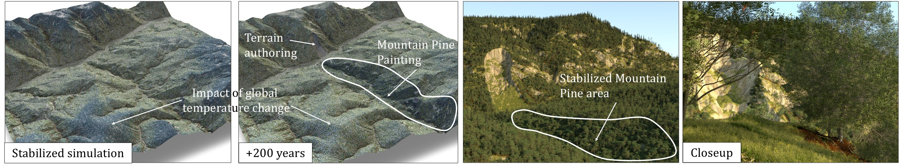
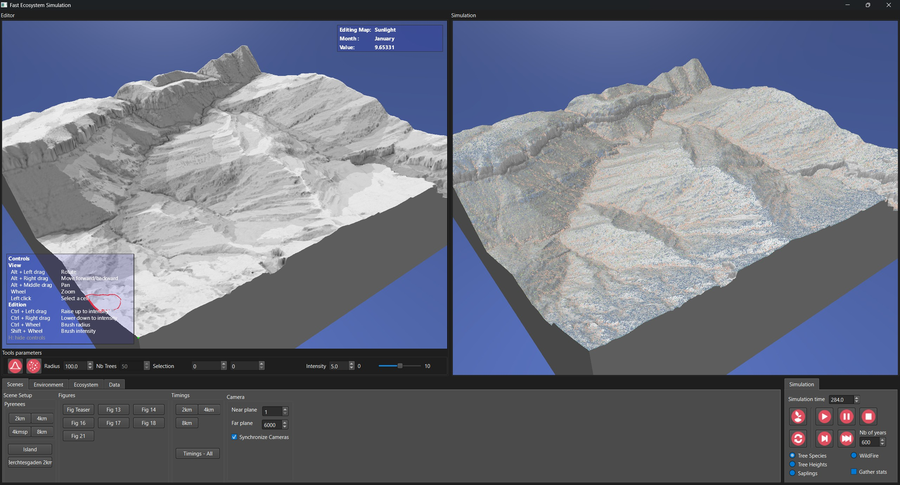

# Interactive Control of Large-Scale Ecosystem Simulation



**Interactive Control of Large-Scale Ecosystem Simulation.**
*Célian Louis-Itty, Adrien Peytavie, James Gain, Eric Guérin, Oscar Argudo and Eric Galin.* 
ACM Transactions on Graphics, presented at SIGGRAPH Asia 2026. 
Authors' implementation.

*Abstract*: Plant ecosystems are an essential element in bringing virtual worlds to life. However, current  modeling methods do not scale well to large virtual environments due to the complexity of the interactions between individual trees required to accurately model realistic plant distributions. The resulting lengthy run-times also hamper authoring. To address the twin demands of scalability and interactive authoring, we introduce a hybrid grid-based simulation that distinguishes between the individual modeling of mature trees, whose interactions are encoded with convolution-like operations, and the aggregate modeling of small trees (encompassing saplings and bushes), which are encoded using a per-cell mean-tree representation. 
Our simulation model is well-suited to parallelization and operates efficiently on graphics hardware, outperforming existing ecosystem simulation approaches by three orders of magnitude without sacrificing ecological consistency and fundamental emergent phenomena. It also enables a full range of interactive control: artists and designers can directly steer the simulation through a painting interface, tune global ecological or climate parameters on the fly, and immediately observe the impact of their choices, making the system suitable for interactive authoring of virtual ecosystems, at a landscape scale of up to 8 x 8 km^2 and 100 million trees (at update rates below 47 ms per simulated year).
Much larger ecosystems (e.g., 24 x 24 km^2 with 975 million trees) can still be simulated in about 413 ms per simulated year.


## Description

This repository contains the authors' implementation of the paper, with the addition of a UI interface and an interactive view of the simulation.



### Compiling the code

We provide a Visual Studio solution, and a CMakeLists.txt. It has been tested on Windows 11 and Debian 13.


#### Dependencies

The project uses Qt 6.10. The library is *not included* in this repository. 

On Windows, the build system expects it to be available via the ```QTDIR64``` environment variable, pointing to the root directory of the installation. To copy the dlls, run ```Script/Deploy.bat``` or ```Script/Deploy.bat <cmake build dir>``` if compiling with cmake.


### Running the application

#### Reproducing results from the paper

In the **Scenes** tab, each button under the **Figures** group (2nd column) reproduces the corresponding figure from the paper. For each figure, the application automatically loads the appropriate scene, runs the simulation, and executes any scripted interactions without requiring further user input.

Under the **Timings** group, benchmarks can be run for various terrain sizes. A render of the tree crowns of the resulting ecosystem is also made.

All results are saved in the ```results/``` folder.

#### Loading a scene

- **Loading a default scene:** In the first tab, select on of the buttons in the **Scene Setup** group (first column). This loads the corresponding abiotics maps, and ecosystem.
- **Creating a new scene:** Open the **Environment** tab and configure the terrain dimensions and elevation range. Then, load the heightfield. Once the terrain is loaded, click **Compute Maps** in the **Environment** group to generate the abiotic maps. You will be prompted to select a folder in which to save the environment. By default, the application uses the Pyrenean species. You can create a new ecosystem in the **Ecosystem** tab.
- **Loading a custom environment:** Open the **Environment** tab and click the corresponding button in the second group.

#### Running the simulation

The simulation controls are located in the bottom-right corner of the interface. You can run the simulation continuously or specify the number of years to simulate.

The left-hand display shows the input maps (e.g., abiotic maps and LIF), while the right-hand display shows the simulation output. By default, each colored pixel represents a single mature tree, with the color indicating its species. You can select other display options in the simulation controls to visualize tree heights or sapling heights.

#### Editing the environment and ecosystem

Pause the simulation before making changes.

In the **Environment** tab, you can edit the abiotic maps, introduce gradual changes in moisture or temperature, and simulate wildfires.

In the **Ecosystem** tab, you can edit species parameters and modify species-specific simulation data, including sapling and mature-tree distributions, as well as the boost map, which increases or decreases the vigor of a given species.

#### Viewing the simulation results

In the **Data** tab, different data can be gathered from the simulation: 
- **Charts:** Generate histograms of tree heights and view basal area statistics. 
**Important:** To collect basal area statistics, enable **Gather stats** in the simulation options before loading the scene. This ensures that the required data is collected at the end of each simulated year.
- **Tree crowns:** Visualize tree crowns as circles in a 2D image or in a 3D render.
- **Vigor visualization:** Visualize the vigor of a selected species. You can enable or disable individual components to identify which abiotic parameter limits vigor in different parts of the terrain.


## Article

The article is published in [ACM Transactions on Graphics](https://doi.org/10.1145/3842499)

If you use this code, please cite the paper:

```bibtex
@article{LouisItty2026,
  author  = {Louis-Itty, C{\'e}lian and Peytavie, Adrien and Gain, James
             and Gu{\'e}rin, Eric and Argudo, Oscar and Galin, Eric},
  title   = {Interactive Control of Large-Scale Ecosystem Simulation},
  journal = {ACM Transactions on Graphics},
  volume  = {45},
  number  = {6},
  year    = {2026},
  month   = dec,
  doi     = {10.1145/3842499},
  url     = {https://doi.org/10.1145/3842499}
}
```